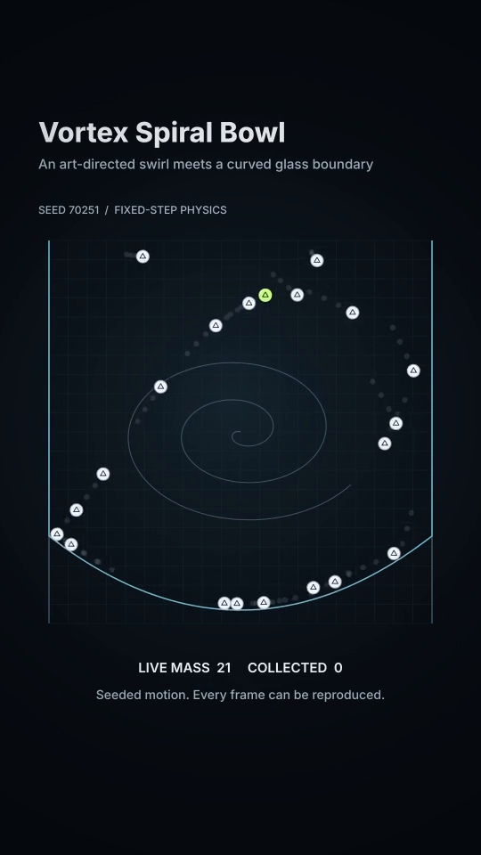

  

# animations

Five animations built from TypeScript, a canvas, and a clock. Change the physics, scrub to any frame, and render the result as a 60 fps video.

Every composition is 1080 × 1920 and runs for 15 seconds: twelve seconds of motion, followed by a three-second code end card. Shapes and emblems are drawn procedurally. Sound is synthesized locally from simulation events. No stock footage, logo files, or music downloads are needed.

## A few frames

| Bumper matrix | Pendulum cascade |
| --- | --- |
|  |  |

| Vortex bowl | Funnel merge |
| --- | --- |
|  |  |

| Pendulum wave | Shared closing beat |
| --- | --- |
|  |  |

## The compositions

| Composition ID | What happens | Good first remix |
| --- | --- | --- |
| `PinballBumperMatrix` | Falling discs bounce through a matrix of circular bumpers. | Move the bumpers, change gravity, or adjust restitution. |
| `PendulumCascade` | Four driven pendulums exchange momentum with falling discs. | Change their periods, amplitude, or pivot positions. |
| `VortexSpiralBowl` | An art-directed vortex field pushes discs around a curved glass bowl. | Tune the swirl, drag, and bowl curvature. |
| `SplitLaneFunnelMerge` | Two inlets feed a bowl. Equal tiers merge, carrying their mass, area, and momentum forward. | Change the inlet spacing or maximum tier. |
| `PendulumWave` | Twelve closed-form oscillators drift out of alignment, then return after one loop. | Change the cycle counts or string lengths. |

## Run locally

Use Node.js 24 and pnpm 10.33.0. A Chromium browser is needed for rendering; Remotion can provision its browser when first used.

~~~sh
git clone https://github.com/oyren-ai/animations.git
cd animations
pnpm install --frozen-lockfile --ignore-scripts
pnpm studio
~~~

Studio opens the composition picker. Scrub through a scene, inspect a contact, or jump to the closing beat. Fonts are bundled through an installed font package; generated sound and manifests are rebuilt by the preview and render commands.

Render the default composition:

~~~sh
pnpm render
~~~

Choose a composition and output filename:

~~~sh
pnpm render SplitLaneFunnelMerge out/funnel.mp4
pnpm render PendulumWave out/wave.mp4
~~~

The render command uses H.264, limited-range BT.709, yuv420p, and one render worker. PNG source frames preserve the intended palette through color conversion. Extra Remotion CLI flags follow the filename:

~~~sh
pnpm render VortexSpiralBowl out/vortex-preview.mp4 --scale=0.5
pnpm still PinballBumperMatrix out/pinball.png --frame=240
~~~

An existing compatible browser can be selected with `REMOTION_BROWSER_EXECUTABLE`. Output goes in `out/`; generated WAV files and the deterministic asset manifest go in `public/generated/`. Both directories are ignored by Git.

## Run & remix in an Oyren Codespace

  

[Open an Oyren Codespace](https://oyren.ai/codespaces) to work on the animations in a cloud Linux environment with a terminal and browser preview.

1. Create a Codespace, open its terminal, and clone this repository using the commands above.
2. Install the dependencies and run `pnpm studio`.
3. Expose Studio on port 3000 through the Codespace preview:

   ~~~sh
   oyren route add / 3000 "Animation Studio"
   ~~~

4. Open the preview from the Codespace. Use a configured terminal coding agent, such as Claude Code, Codex, Gemini CLI, or opencode, to edit the physics and render a new MP4.

Try a bounded prompt:

> In PinballBumperMatrix, make the bumper grid wider and lower gravity by 15%. Keep the seeded simulation, conservation tests, safe text bounds, and code end card. Run the tests, then render a 60 fps preview.

Commit and push remixes to keep them across machine changes. Leave the source link in the closing beat so the next person can find the code.

## How the simulation works

The ball scenes use a local seeded pseudorandom generator and eight fixed integration substeps per video frame. Each contact resolves penetration and the inward normal velocity. Moving paddle contacts use the paddle's velocity at the contact point.

The bowl uses the inward normal offset of a parabola. Simply subtracting a disc's radius from the floor height would allow the disc's sides to cross a sloped wall. The solver finds the actual tangent contact; tests sample the full circumference.

Matching funnel discs combine by mass-weighted position and velocity. The new radius is the square root of the sum of squared radii, preserving disc area. Other contacts use a restitution impulse. The vortex and pendulum drives are deliberate visual forces; their parameters are exposed in source.

The pendulum wave uses an analytic trajectory. Each successive oscillator completes one extra cycle in the same twelve-second interval, so all return to their opening positions together.

## Where to change things

| File | Responsibility |
| --- | --- |
| `src/settings.ts` | Dimensions, frame rate, scene length, and end-card length |
| `src/theme.ts` | Palette, typography, easing, and spring settings |
| `src/ball-drop/sim.ts` | Seeds, spawn rules, bumpers, moving paddles, vortex forces, and merges |
| `src/ball-drop/bounds.ts` | Disc, segment, world, bowl, and measured text bounds |
| `src/ball-drop/paint.ts` | The canvas frame renderer and procedural geometric emblems |
| `src/pendulum-wave/wave.ts` | The closed-form oscillator |
| `src/audio.ts` | Event-to-tone mapping and PCM synthesis |
| `src/encoding.ts` | Explicit PNG-to-BT.709 conversion for the pinned renderer |
| `src/components/GetTheCodeEndCard.tsx` | Shared closing copy and repository link |

## Verify a remix

~~~sh
pnpm typecheck
pnpm test
pnpm assets
~~~

Tests cover seeded replay, mass and disc-area conservation, moving contacts, curved boundaries, safe text bounds, exact oscillator derivatives, deterministic audio duration and peak levels, and the rendered end-card link. Run these checks locally on Node.js 24 before sharing a remix.

Render and inspect frames after changing the layout or motion. A passing typecheck does not inspect pixels.

## License

The source in this repository is [MIT licensed](LICENSE), copyright 2026 Oyren. Dependencies retain their own licenses, including [Remotion's licensing terms](https://www.remotion.dev/license).
