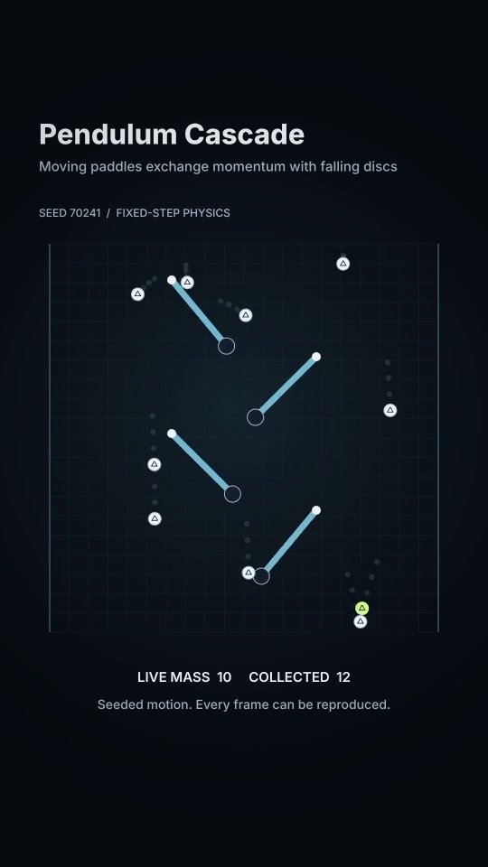
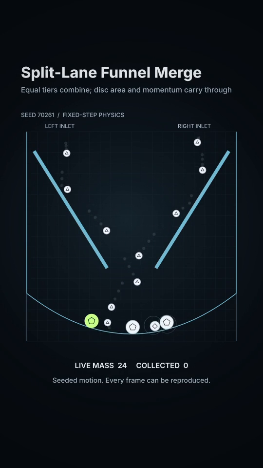
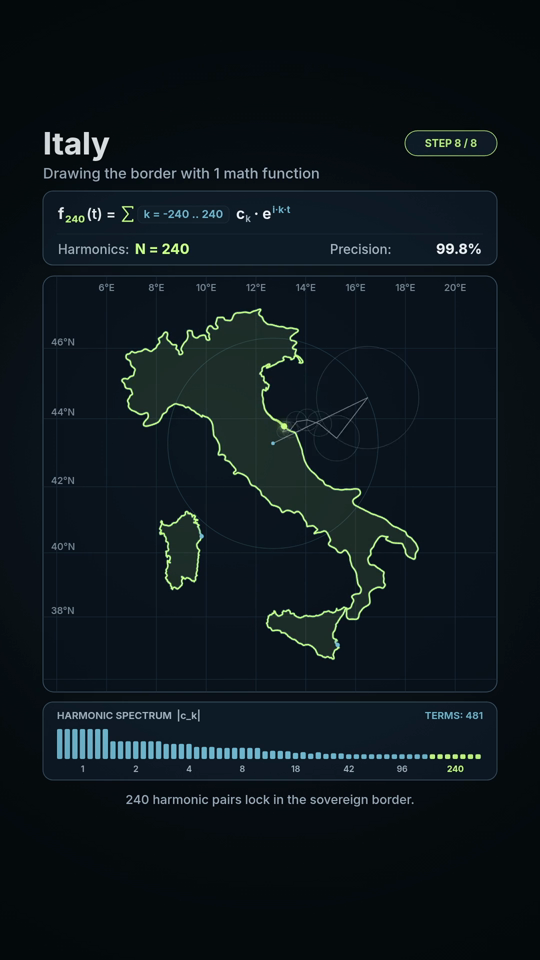
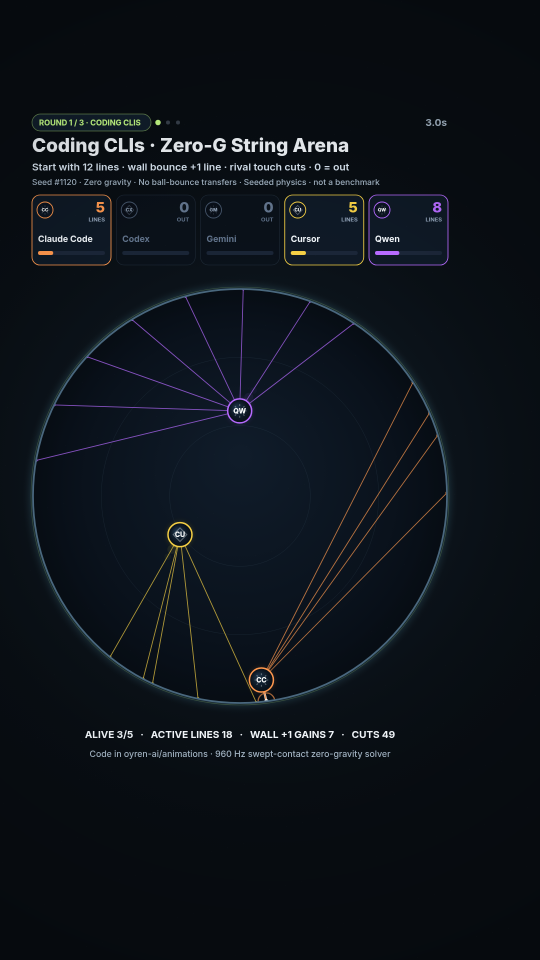
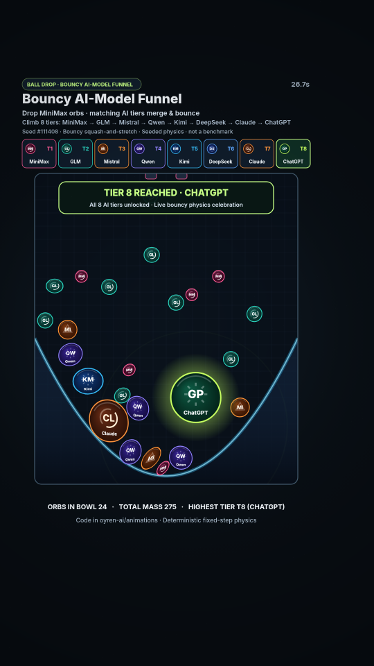
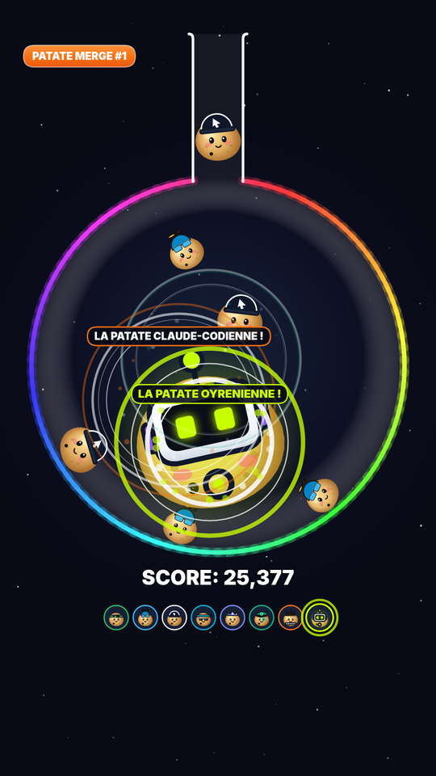
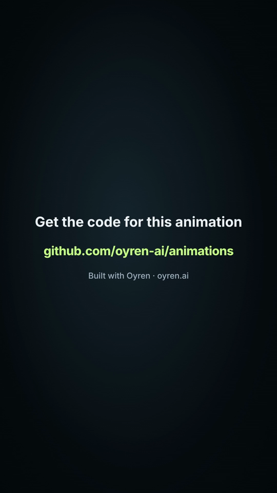

  

# animations

Twenty-two animations built from TypeScript, a canvas, and a clock: five foundational physics scenes, five complex-Fourier country-border reconstructions, four zero-gravity wall-bounce string-arena compositions, five bouncy arcade ball-drop and funnel-merge compositions, and three Suika-style Patate Merge boiling-flask compositions with pitch-coupled French voice announcements. Change the equations or physics, scrub to any frame, and render the result as a 60 fps video.

Every composition renders at 1080 × 1920 and 60 fps, closing with a code end card pointing to `github.com/oyren-ai/animations`. Shapes, sovereign map contours, cartoon potato costumes, and geometric vector emblems are drawn procedurally. Sound is synthesized and mixed locally from simulation events and self-generated voice stems. No stock footage, third-party logo files, or music downloads are needed.

## A few frames

| Bumper matrix | Pendulum cascade |
| --- | --- |
|  |  |

| Vortex bowl | Funnel merge |
| --- | --- |
|  |  |

| Pendulum wave | Azerbaijan (Fourier map) |
| --- | --- |
|  |  |

| Turkey (Fourier map) | India (Fourier map) |
| --- | --- |
|  |  |

| Italy (Fourier map) | Japan (Fourier map) |
| --- | --- |
|  |  |

| Zero-G string arenas (combined) | Bouncy 8-tier funnel merge |
| --- | --- |
|  |  |

| Four-stage arcade ball drop | Patate Merge: Coding Agents |
| --- | --- |
|  |  |

| Patate Merge: World to Code | Patate Merge: Languages |
| --- | --- |
|  |  |

| Shared closing beat |  |
| --- | --- |
|  |  |

## The compositions

| Composition ID | What happens | Good first remix |
| --- | --- | --- |
| `PinballBumperMatrix` | Falling discs bounce through a matrix of circular bumpers. | Move the bumpers, change gravity, or adjust restitution. |
| `PendulumCascade` | Four driven pendulums exchange momentum with falling discs. | Change their periods, amplitude, or pivot positions. |
| `VortexSpiralBowl` | An art-directed vortex field pushes discs around a curved glass bowl. | Tune the swirl, drag, and bowl curvature. |
| `SplitLaneFunnelMerge` | Two inlets feed a bowl. Equal tiers merge, carrying their mass, area, and momentum forward. | Change the inlet spacing or maximum tier. |
| `PendulumWave` | Twelve closed-form oscillators drift out of alignment, then return after one loop. | Change the cycle counts or string lengths. |
| `MapOfAzerbaijan` | Sovereign mainland Azerbaijan and Nakhchivan sharpen across eight complex Fourier orders (`N = 1` to `240`). | Add another country polygon or change the harmonic schedule. |
| `MapOfTurkey` | Anatolia and Eastern Thrace emerge across eight harmonic orders with live epicycles and spectrum bars. | Adjust epicycle chain count or morph duration. |
| `MapOfIndia` | Complete India border converges from an `N = 1` ellipse to `N = 240` harmonic pairs. | Inspect individual frequency modes or grid spacing. |
| `MapOfItaly` | Peninsular Italy, Sardinia, and Sicily reconstruct simultaneously as separate closed Fourier loops. | Compare island convergence rates across low orders. |
| `MapOfJapan` | Honshu, Kyushu, Hokkaido, and Shikoku sharpen from four ellipses into archipelago coastlines. | Tune the harmonic bell chord voicings in `src/audio.ts`. |
| `StringArenasCombined` | Three back-to-back zero-gravity string-arena rounds (`Coding CLIs`, `Languages`, `Frameworks`) where rim bounces add `+1` anchored line and rival crossings cut lines. | Change `initialStrings`, arena radius, or round seeds in `src/string-arena/sim.ts`. |
| `StringArenaCodingClis` | Standalone Round 1 zero-gravity string arena (`Seed #1120`). | Adjust bounce speed floors or contender palette. |
| `StringArenaLanguages` | Standalone Round 2 zero-gravity string arena (`Seed #2213`). | Experiment with 6 contenders or wider starting fans. |
| `StringArenaFrameworks` | Standalone Round 3 zero-gravity string arena (`Seed #3274`). | Customize elimination burst particle density. |
| `DropPlinkoGates` | Peg-matrix cascade through `+2` and `x2` laser gates shattering five stacked energy shields. | Add new gate operators or shield thresholds. |
| `DropBreakableRings` | Six rotating segmented neon rings crack on impact until an orb enters the core and escapes to the goal. | Change ring rotation speeds or segment hit points. |
| `DropLogoFunnelMerge` | Bouncy, squishy jewel-toned orbs merge up an eight-tier progression ladder with a live 3.5 s Tier-8 celebration. | Tune spring-damped squash stiffness, restitution, or tier radii. |
| `DropPinballBumpers` | Five `+15` bumpers and twin `x2` rotors charge falling orbs to fill a wave-rippled neon score tank. | Reposition rotors or raise the tank target. |
| `BallDropCombined` | Four-stage combined arcade showcase chaining Plinko gates, breakable rings, bouncy 8-tier funnel merge, and pinball bumpers. | Reorder stages or tune compact stage seeds. |
| `PatateMergeCodingAgents` | Costumed coding-agent potatoes drop down a glass neck and merge up an 8-tier rainbow flask (*copilotienne* → *codexienne* → *claude-codienne* → *oyrenienne*) with pitch-scaled French voice callouts. | Swap tier playback rates, radii, or costumes in `src/patate/themes.ts`. |
| `PatateMergeWorldToCode` | Classic world-patate progression (*turque*, *mexicaine*, *italienne*, *française*) plot-twisting at Tier 6 into *codexienne*, *claude-codienne*, and *oyrenienne*. | Change drop cadence or chain-reaction radial impulse in `src/patate/sim.ts`. |
| `PatateMergeLanguages` | Eight-tier programming-language patate evolution (*bashienne* → *javascriptienne* → *pythonienne* → *typescriptienne* → *go-langienne* → *rustienne* → *lean-quatrienne*). | Add a new language costume in `src/patate/paint.ts` or adjust interrupt timing in `src/patate/audio.ts`. |

## Run locally

Use Node.js 24 and pnpm 10.33.0. A Chromium browser is needed for rendering; Remotion can provision its browser when first used.

~~~sh
git clone https://github.com/oyren-ai/animations.git
cd animations
pnpm install --frozen-lockfile --ignore-scripts
pnpm studio
~~~

Studio opens the composition picker. Scrub through a scene, inspect a contact, or jump to the closing beat. Fonts are bundled through an installed font package; generated sound and manifests are rebuilt by the preview and render commands.

Render the default composition:

~~~sh
pnpm render
~~~

Choose a composition and output filename:

~~~sh
pnpm render SplitLaneFunnelMerge out/funnel.mp4
pnpm render PendulumWave out/wave.mp4
pnpm render MapOfAzerbaijan out/map-of-azerbaijan.mp4
~~~

The render command uses H.264, limited-range BT.709, yuv420p, and one render worker. PNG source frames preserve the intended palette through color conversion. Extra Remotion CLI flags follow the filename:

~~~sh
pnpm render VortexSpiralBowl out/vortex-preview.mp4 --scale=0.5
pnpm still PinballBumperMatrix out/pinball.png --frame=240
~~~

An existing compatible browser can be selected with `REMOTION_BROWSER_EXECUTABLE`. Output goes in `out/`; generated WAV files and the deterministic asset manifest go in `public/generated/`. Both directories are ignored by Git.

## Run & remix in an Oyren Codespace

  

[Open an Oyren Codespace](https://oyren.ai/codespaces) to work on the animations in a cloud Linux environment with a terminal and browser preview.

1. Create a Codespace, open its terminal, and clone this repository using the commands above.
2. Install the dependencies and run `pnpm studio`.
3. Expose Studio on port 3000 through the Codespace preview:

   ~~~sh
   oyren route add / 3000 "Animation Studio"
   ~~~

4. Open the preview from the Codespace. Use a configured terminal coding agent, such as Claude Code, Codex, Gemini CLI, or opencode, to edit the physics and render a new MP4.

Try a bounded prompt:

> In PinballBumperMatrix, make the bumper grid wider and lower gravity by 15%. Keep the seeded simulation, conservation tests, safe text bounds, and code end card. Run the tests, then render a 60 fps preview.

Commit and push remixes to keep them across machine changes. Leave the source link in the closing beat so the next person can find the code.

## How the simulation works

The ball scenes use a local seeded pseudorandom generator and eight fixed integration substeps per video frame. Each contact resolves penetration and the inward normal velocity. Moving paddle contacts use the paddle's velocity at the contact point.

The bowl uses the inward normal offset of a parabola. Simply subtracting a disc's radius from the floor height would allow the disc's sides to cross a sloped wall. The solver finds the actual tangent contact; tests sample the full circumference.

Matching funnel discs combine by mass-weighted position and velocity. The new radius is the square root of the sum of squared radii, preserving disc area. Other contacts use a restitution impulse. The vortex and pendulum drives are deliberate visual forces; their parameters are exposed in source.

The pendulum wave uses an analytic trajectory. Each successive oscillator completes one extra cycle in the same twelve-second interval, so all return to their opening positions together.

The country-map scenes project Natural Earth `10m` closed sovereign rings with spherical Mercator coordinates so east-west distances match cosine-latitude aspect ratios. Each closed loop is decomposed by exact complex discrete Fourier transform across modes `k = -240 .. 240`, then reconstructed through eight progressive harmonic orders (`N = 1, 2, 4, 8, 18, 42, 96, 240`) with smooth order morphing, rotating epicycle vectors, and live normalized `L2` contour precision.

The zero-gravity string arenas integrate 16 substeps per video frame (`960 Hz`) and solve exact swept polynomial contacts between moving contender discs and anchored chords. Each contender opens with 12 rim-anchored lines, gains `+1` line anchored at the exact rim impact point on wall bounces (never on ball-ball collisions), cuts rival lines on contact, and bursts across a centre-filled Fermat disc when its line count reaches zero.

The four-stage arcade ball-drop scenes pair 480 Hz fixed-step collision resolution with an underdamped squash-and-stretch spring (`scaleNormal = 1 - s`, `scaleTangent = 1 / (1 - s)`) aligned to each impact normal while keeping emblems upright, plus live post-climax physics across the celebration window.

The Patate Merge scenes integrate 240 Hz rigid-body circle dynamics with rotational friction inside a narrow top neck chute joined to a circular boiling flask (`R = 462 px`). Identical tiers (`1` through `7`) merge into the next tier (`32 px` up to `178 px`), triggering concentric shockwaves, radial impulses, 8-slot portrait unlocks, and Catmull-Rom coupled pitch-and-speed resampled French announcements (`1.38×` down to `0.64×`) with chain-merge vocal interrupts.

## Where to change things

| File | Responsibility |
| --- | --- |
| `src/settings.ts` | Dimensions, frame rate, scene length, and end-card length |
| `src/theme.ts` | Palette, typography, easing, and spring settings |
| `src/ball-drop/sim.ts` | Seeds, spawn rules, bumpers, moving paddles, vortex forces, and merges |
| `src/ball-drop/bounds.ts` | Disc, segment, world, bowl, and measured text bounds |
| `src/ball-drop/paint.ts` | The canvas frame renderer and procedural geometric emblems |
| `src/pendulum-wave/wave.ts` | The closed-form oscillator |
| `src/data/countryContours.ts` | Arc-length resampled WGS84 sovereign border loops for the five countries |
| `src/country-maps/fourier.ts` | Spherical Mercator projection, complex DFT, harmonic tiers, and epicycle evaluation |
| `src/country-maps/paint.ts` | Canvas map renderer, coordinate grid, formula telemetry, and harmonic spectrum |
| `src/string-arena/sim.ts` | Zero-gravity 960 Hz swept-contact string solver, rim-gain rules, and three-round timeline |
| `src/string-arena/paint.ts` | Reel-safe (`x: 60..900`, `y: 220..1560`) string-arena HUD, chords, and full-disc bursts |
| `src/drop-arenas/sim.ts` | Plinko gates, breakable rings, bouncy 8-tier funnel merge, pinball bumpers, and squash springs |
| `src/drop-arenas/paint.ts` | High-contrast jewel-toned orb renderer, 8-tier progression strip, and arcade obstacles |
| `src/patate/themes.ts` | Patate Merge tier ladders, radii, coupled pitch rates, French stems, and costume IDs |
| `src/patate/sim.ts` | 240 Hz boiling-flask + chute rigid-body solver, rolling spin, and Suika chain merges |
| `src/patate/paint.ts` | Rotating rainbow flask wall, 23 cartoon potato costumes, shockwaves, and 8-slot HUD |
| `src/patate/audio.ts` | Coupled `asetrate` French voice resampler, chain-interrupt fades, and tactile SFX mixer |
| `src/shared/reelUtils.ts` | Reel safe-zone bounds assertions and procedural geometric emblem renderer |
| `src/audio.ts` | Event-to-tone mapping, harmonic map chords, arena soundtracks, and PCM synthesis |
| `src/encoding.ts` | Explicit PNG-to-BT.709 conversion for the pinned renderer |
| `src/components/GetTheCodeEndCard.tsx` | Shared closing copy and repository link |

## Verify a remix

~~~sh
pnpm typecheck
pnpm test
pnpm assets
~~~

Tests cover seeded replay, mass and disc-area conservation, moving contacts, curved boundaries, safe text bounds, exact oscillator derivatives, monotonic Fourier contour convergence and Mercator bounds, deterministic audio duration and peak levels, and the rendered end-card link. Run these checks locally on Node.js 24 before sharing a remix.

Render and inspect frames after changing the layout or motion. A passing typecheck does not inspect pixels.

## License

The source in this repository is [MIT licensed](LICENSE), copyright 2026 Oyren. Dependencies retain their own licenses, including [Remotion's licensing terms](https://www.remotion.dev/license).

## MIDI kit

A TypeScript MIDI kit reads and writes Standard MIDI Files and synthesises deterministic stereo WAV audio with zero runtime dependencies.

| File | Responsibility |
| --- | --- |
| `src/midi/parse.ts` | Standard MIDI File reader: formats 0 and 1, running status, tempo map, time signature, SMPTE division, note-on velocity 0 as note-off, track names and programs |
| `src/midi/write.ts` | MIDI writer used to generate `.mid` files from note arrays authored in beats |
| `src/midi/synth.ts` | Offline synthesiser: Karplus-Strong piano, FM bell, marimba and kalimba voices, velocity-dependent brightness, pitch-dependent pan, Schroeder reverb, look-ahead limiter, stereo PCM16 WAV |
| `src/midi/pieces.ts` | Built-in public-domain transcriptions as note data |
| `src/midi/timeline.ts` | Scene timing (lead-in, ring-out), audio file naming, and derived scene data |
| `src/midi/kit.ts` | Seeded random numbers, easing, colour, chord accents, camera kick, glow sprites, and shared title and end fade |
| `src/components/MidiShell.tsx` | Loads the MIDI file, sets the composition length, paints each frame and plays the matching WAV |
| `scripts/generate-midi-assets.ts` | Writes built-in `.mid` files and one WAV per `.mid` in `public/midi` |
| `scripts/render-midi.ts` | Muted Remotion render plus an ffmpeg audio mux for frame-exact sound (`pnpm render:midi`) |
