

  

# animations

Thirty animations built from TypeScript, WebGL2 shaders, a canvas, and a clock: five foundational physics scenes, five complex-Fourier country-border reconstructions, four zero-gravity wall-bounce string-arena compositions, five bouncy arcade ball-drop and funnel-merge compositions, three Suika-style Patate Merge boiling-flask compositions with pitch-coupled French voice announcements, three edge-to-edge full-screen (`1080 × 1920`) GPU shader and 48 kHz stereo audio-reactive compositions, four full-screen photo-finish comeback races verified by mathematical catchup invariants (`docs/COMEBACK-SHORTS.md`), and one English voiceover showcase. Change the equations, shaders, or physics, scrub to any frame, and render the result as a 60 fps video.

Every composition renders at 1080 × 1920 and 60 fps, closing with a code end card pointing to `github.com/oyren-ai/animations` (`MapOfIndia` ends on its own licence line and is silent). Shapes, sovereign map contours, cartoon potato costumes, and geometric vector emblems are drawn procedurally. Sound is synthesized and mixed locally from simulation events and self-generated voice stems. No stock footage, third-party logo files, or music downloads are needed. The one exception to "self-generated" is the `AnimationsRepoShowcase` voiceover, which is AI-generated with Speechify and says so on its end card; see `docs/REPO-SHOWCASE.md`.

## A few frames

| Bumper matrix | Pendulum cascade |
| --- | --- |
| 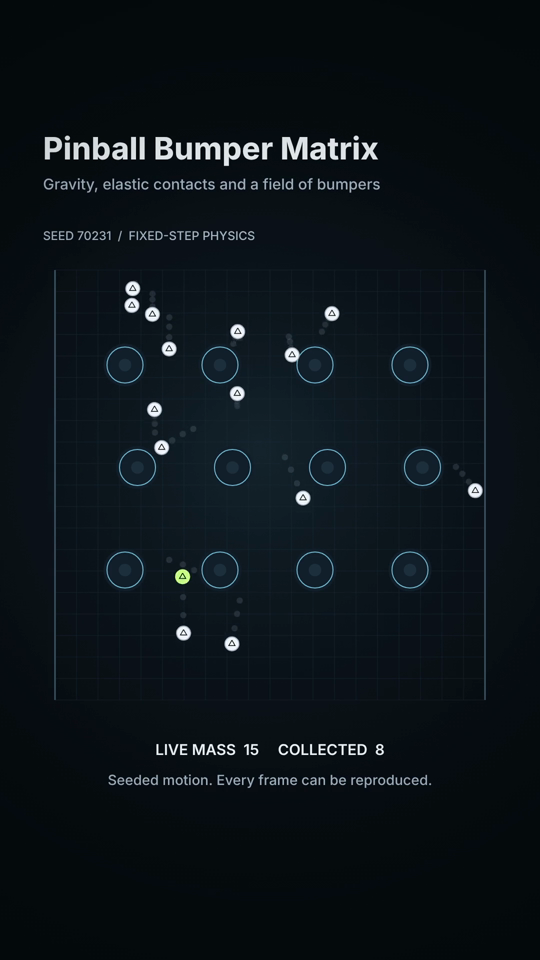 |  |

| Vortex bowl | Funnel merge |
| --- | --- |
|  |  |

| Pendulum wave | Azerbaijan (Fourier map) |
| --- | --- |
| 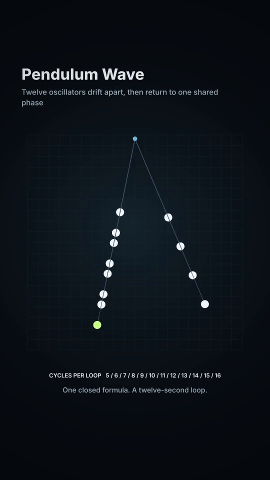 |  |

| Turkey (Fourier map) | India (Fourier map) |
| --- | --- |
|  |  |

| Italy (Fourier map) | Japan (Fourier map) |
| --- | --- |
|  | 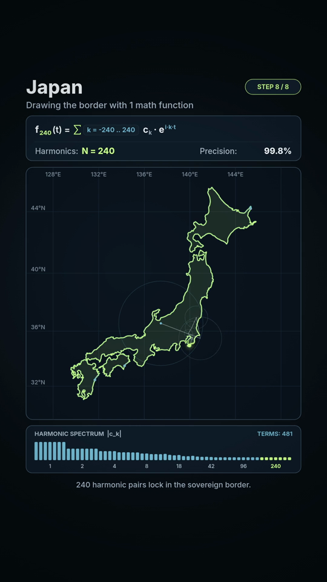 |

| Zero-G string arenas (combined) | Bouncy 8-tier funnel merge |
| --- | --- |
|  |  |

| Four-stage arcade ball drop | Patate Merge: Coding Agents |
| --- | --- |
| 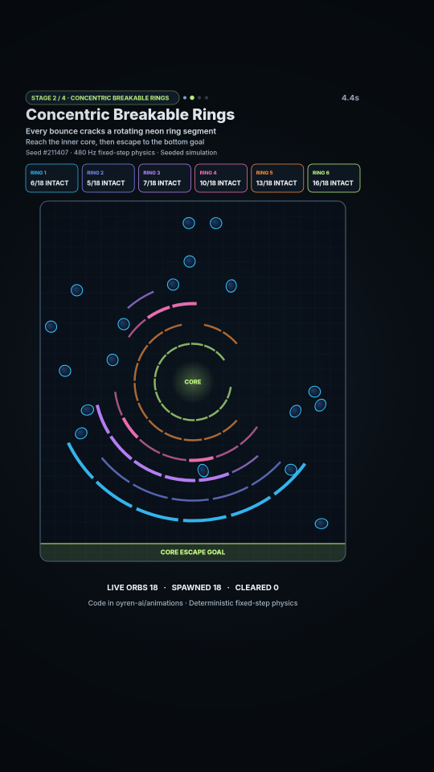 |  |

| Patate Merge: World to Code | Patate Merge: Languages |
| --- | --- |
| 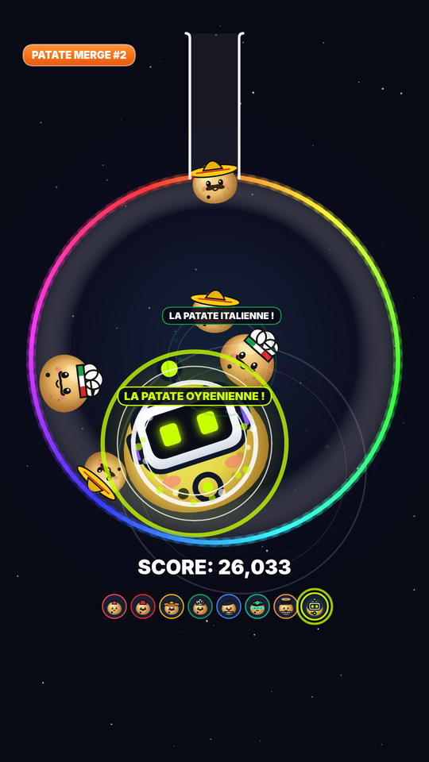 | 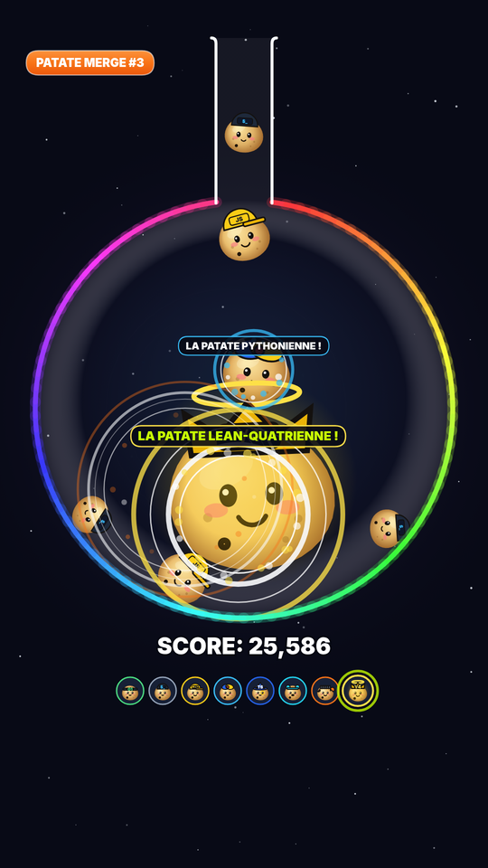 |

| Swarm: rock paper scissors | Swarm: five rivals |
| --- | --- |
| 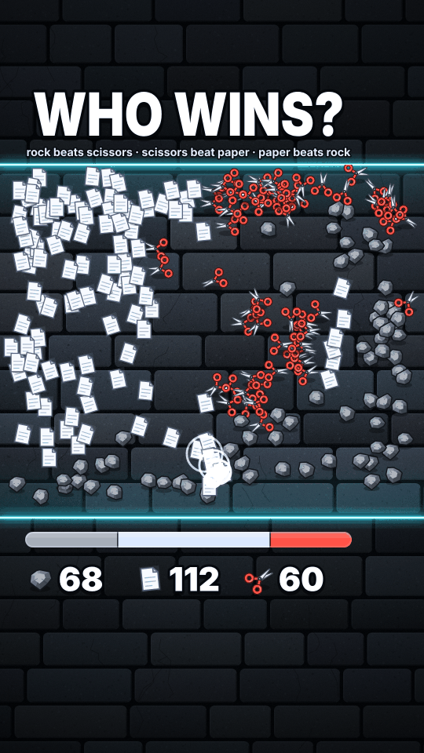 | 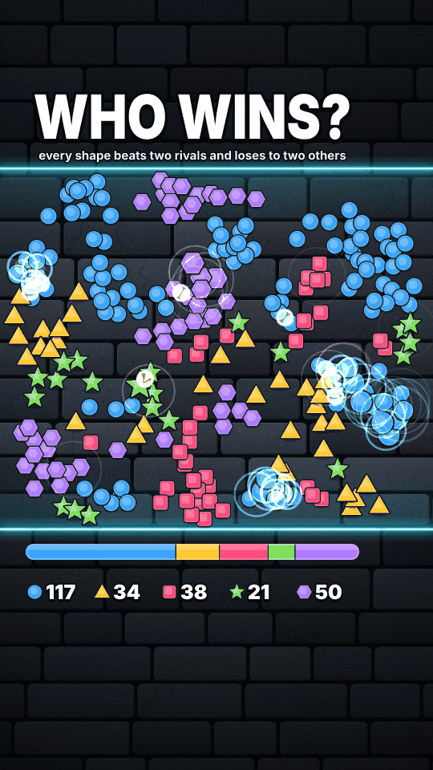 |

| Cyber synth shader tunnel (WebGL2) | Polyphonic wall cascade |
| --- | --- |
| 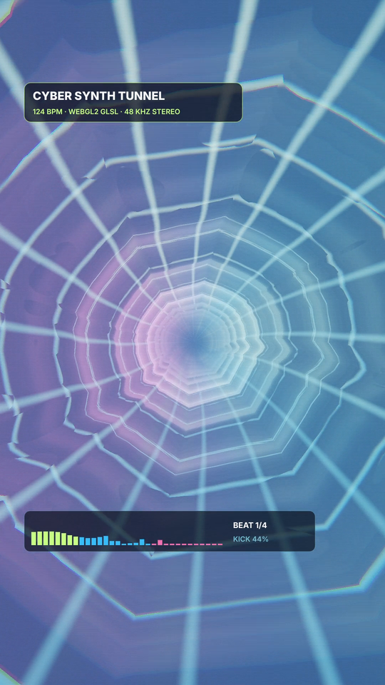 | 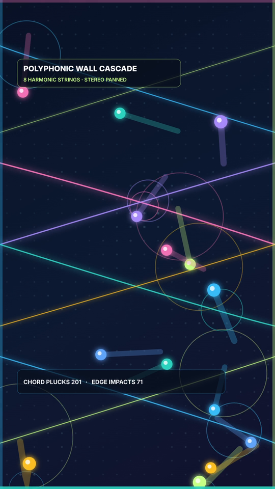 |

| Harmonic sorting matrix | Shared closing beat |
| --- | --- |
| 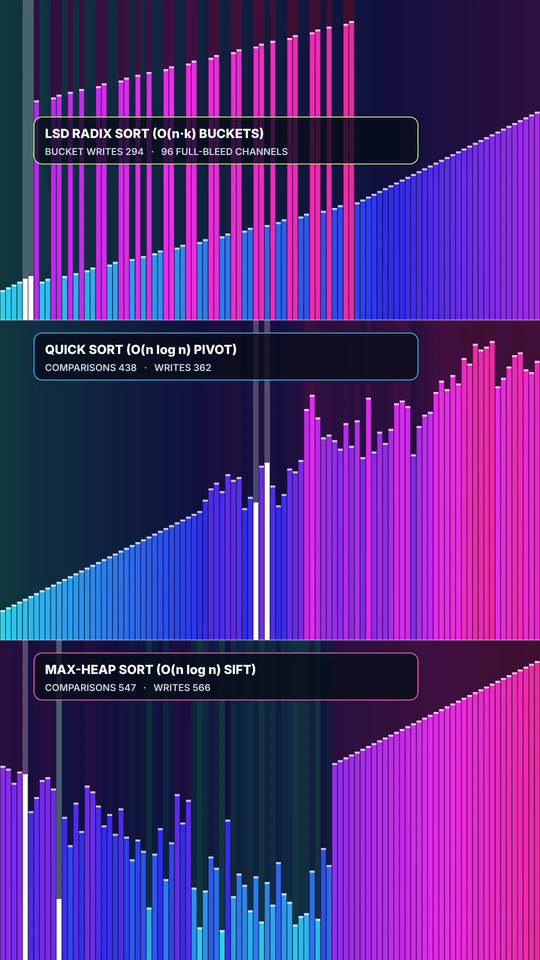 |  |
| Tower: linear vs exponential | Titan hammer vs swarm |
| --- | --- |
| 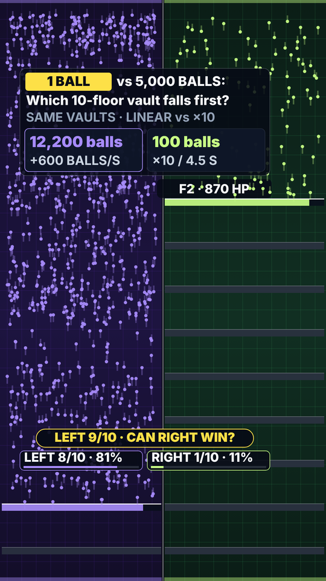 | 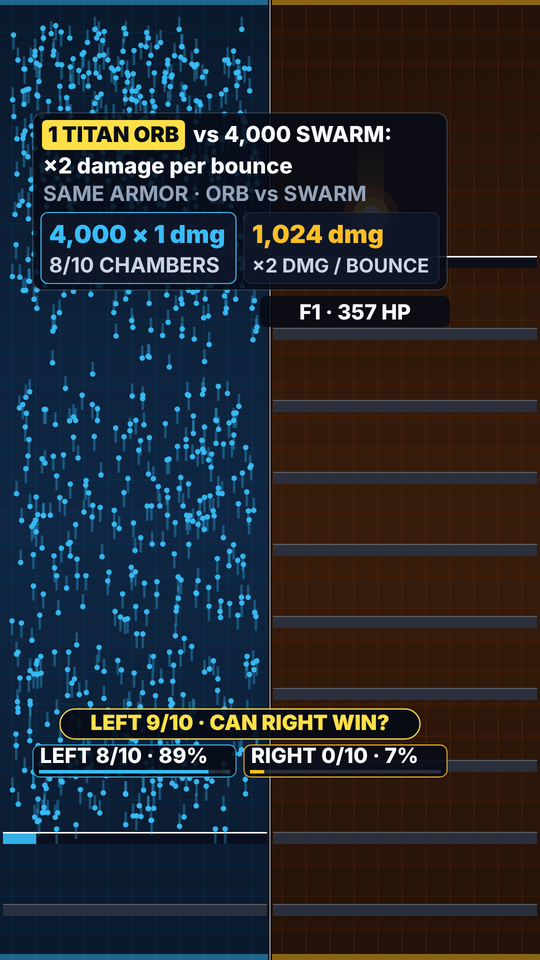 |

| Splitter wall escape | Afterburner lap comeback |
| --- | --- |
| 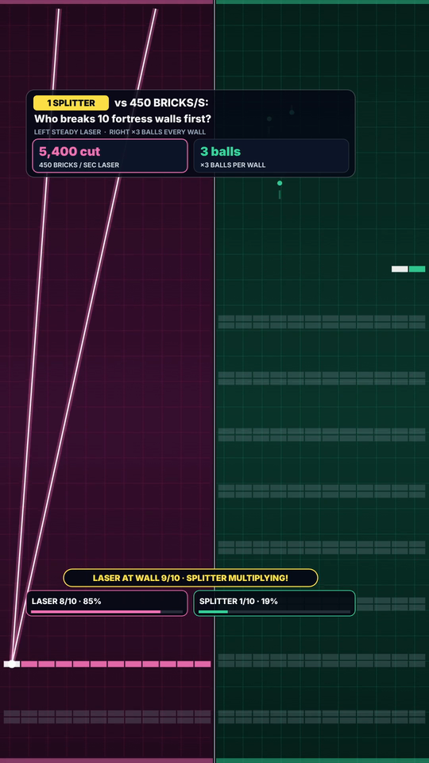 | 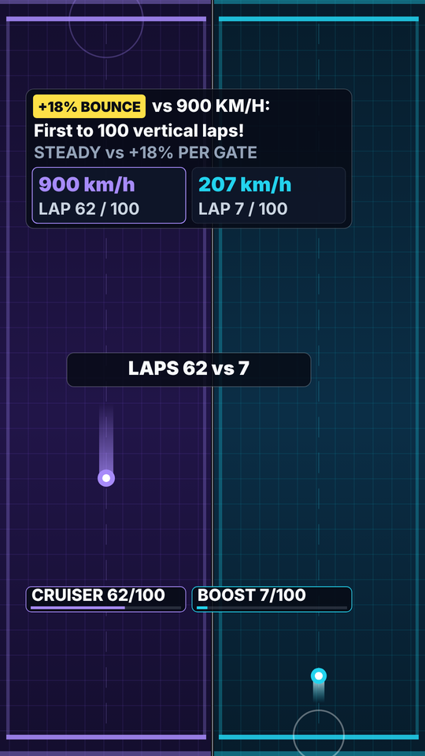 |

## The compositions

| Composition ID | What happens | Good first remix |
| --- | --- | --- |
| `PinballBumperMatrix` | Falling discs bounce through a matrix of circular bumpers. | Move the bumpers, change gravity, or adjust restitution. |
| `PendulumCascade` | Four driven pendulums exchange momentum with falling discs. | Change their periods, amplitude, or pivot positions. |
| `VortexSpiralBowl` | An art-directed vortex field pushes discs around a curved glass bowl. | Tune the swirl, drag, and bowl curvature. |
| `SplitLaneFunnelMerge` | Two inlets feed a bowl. Equal tiers merge, carrying their mass, area, and momentum forward. | Change the inlet spacing or maximum tier. |
| `PendulumWave` | Twelve closed-form oscillators drift out of alignment, then return after one loop. | Change the cycle counts or string lengths. |
| `MapOfAzerbaijan` | Sovereign mainland Azerbaijan and Nakhchivan sharpen across eight complex Fourier orders (`N = 1` to `240`). | Add another country polygon or change the harmonic schedule. |
| `MapOfTurkey` | Anatolia and Eastern Thrace emerge across eight harmonic orders with live epicycles and spectrum bars. | Adjust epicycle chain count or morph duration. |
| `MapOfIndia` | An 82-second explainer: the India border as one complex function `z(t) = x(t) + i y(t)`, rebuilt from tip-to-tail rotating circles one harmonic pair at a time (`N = 1` ellipse, then `2` to `5`, then `8` to `240`, 481 circles) with KaTeX-typeset formulas whose coloured terms match the circles. Silent. | Change the stage list in `src/country-maps/explainer.ts` or the harmonic colours in `src/country-maps/explainer-text.ts`. |
| `MapOfItaly` | Peninsular Italy, Sardinia, and Sicily reconstruct simultaneously as separate closed Fourier loops. | Compare island convergence rates across low orders. |
| `MapOfJapan` | Honshu, Kyushu, Hokkaido, and Shikoku sharpen from four ellipses into archipelago coastlines. | Tune the harmonic bell chord voicings in `src/audio.ts`. |
| `StringArenasCombined` | Three back-to-back zero-gravity string-arena rounds (`Coding CLIs`, `Languages`, `Frameworks`) where rim bounces add `+1` anchored line and rival crossings cut lines. | Change `initialStrings`, arena radius, or round seeds in `src/string-arena/sim.ts`. |
| `StringArenaCodingClis` | Standalone Round 1 zero-gravity string arena (`Seed #1120`). | Adjust bounce speed floors or contender palette. |
| `StringArenaLanguages` | Standalone Round 2 zero-gravity string arena (`Seed #2213`). | Experiment with 6 contenders or wider starting fans. |
| `StringArenaFrameworks` | Standalone Round 3 zero-gravity string arena (`Seed #3274`). | Customize elimination burst particle density. |
| `DropPlinkoGates` | Peg-matrix cascade through `+2` and `x2` laser gates shattering five stacked energy shields. | Add new gate operators or shield thresholds. |
| `DropBreakableRings` | Six rotating segmented neon rings crack on impact until an orb enters the core and escapes to the goal. | Change ring rotation speeds or segment hit points. |
| `DropLogoFunnelMerge` | Bouncy, squishy jewel-toned orbs merge up an eight-tier progression ladder with a live 3.5 s Tier-8 celebration. | Tune spring-damped squash stiffness, restitution, or tier radii. |
| `DropPinballBumpers` | Five `+15` bumpers and twin `x2` rotors charge falling orbs to fill a wave-rippled neon score tank. | Reposition rotors or raise the tank target. |
| `BallDropCombined` | Four-stage combined arcade showcase chaining Plinko gates, breakable rings, bouncy 8-tier funnel merge, and pinball bumpers. | Reorder stages or tune compact stage seeds. |
| `PatateMergeCodingAgents` | Costumed coding-agent potatoes drop down a glass neck and merge up an 8-tier rainbow flask (*copilotienne* → *codexienne* → *claude-codienne* → *oyrenienne*) with pitch-scaled French voice callouts. | Swap tier playback rates, radii, or costumes in `src/patate/themes.ts`. |
| `PatateMergeWorldToCode` | Classic world-patate progression (*turque*, *mexicaine*, *italienne*, *française*) plot-twisting at Tier 6 into *codexienne*, *claude-codienne*, and *oyrenienne*. | Change drop cadence or chain-reaction radial impulse in `src/patate/sim.ts`. |
| `PatateMergeLanguages` | Eight-tier programming-language patate evolution (*bashienne* → *javascriptienne* → *pythonienne* → *typescriptienne* → *go-langienne* → *rustienne* → *lean-quatrienne*). | Add a new language costume in `src/patate/paint.ts` or adjust interrupt timing in `src/patate/audio.ts`. |
| `CyberSynthShaderTunnel` | Full-bleed `1080 × 1920` WebGL2 `#version 300 es` raymarched octagonal synthwave tunnel whose ribs, chromatic dispersion, and shock rings pulse to a 124 BPM 48 kHz stereo score. | Change the GLSL distance field or chord progression in `src/gpu-scenes/cyberTunnel.ts`. |
| `PolyphonicWallCascade` | Fourteen luminous orbs bounce edge-to-edge across the entire `0..1080 × 0..1920` acoustic chamber, plucking eight full-span harmonic strings with stereo-panned FM chords. | Retune `HARMONIC_STRINGS` or orb count in `src/gpu-scenes/wallCascade.ts`. |
| `HarmonicSortingMatrix` | Full-bleed three-band `1080 × 1920` race comparing LSD Radix Sort, Median-of-3 Quick Sort, and Max-Heap Sort over 96 channels with stereo Lydian-pentatonic arpeggios. | Swap sorting algorithms or scale intervals in `src/gpu-scenes/harmonicSorting.ts`. |
| `TowerLinearVsExponential` | Full-bleed twin 10-floor vaults (`5,000` balls `+600/s` vs `1` ball `x10 every 4.5s`) where compounding overtakes in the final seconds. | Retune floor hit-point scaling or multiplication cadence in `src/comebacks/towerVaults.ts`. |
| `TitanHammerVsSwarm` | Full-bleed twin armored vaults (`4,000` micro balls `1 dmg` vs `1` Titan orb `x2 dmg/bounce`) ending in a multi-floor overkill cleave. | Adjust Titan bounce acceleration or armor curve in `src/comebacks/towerVaults.ts`. |
| `SplitterWallEscape` | Ten-layer neon brick fortress (`450 bricks/s` sweeping dual lasers vs `1` Splitter orb `x3 balls per wall`) ending in a `19,683`-ball avalanche. | Change `FORTRESS_WALL_BRICKS` or split factor in `src/comebacks/splitterFortress.ts`. |
| `AfterburnerLapComeback` | Vertical 100-lap speedway (`900 km/h` steady cruiser vs `+18%` speed per gate bounce) with relativistic wake blur and Shepard riser. | Adjust `RIGHT_BOUNCE_MULTIPLIER` or overdrive ceiling in `src/comebacks/afterburnerLaps.ts`. |
| `AnimationsRepoShowcase` | A 24-second short that introduces this repo with an English AI voiceover (Speechify). Cuts, word-highlight captions and a remix demo follow the measured voice clips; the footage is this repo's own pendulum, ball-drop, string-arena and Fourier-map scenes. | Edit the lines in `src/repo-showcase/script.ts`, regenerate the voice with `scripts/generate-showcase-voice.ts`, and re-render. |
| `SwarmRpsClassic` | 180 slate-blue rock gems, ice-white code-sheet papers, and bold lime-bladed scissors start packed on three sides of a centred Oyren workspace arena (symmetric triangle, centroids ≥ 621 px apart), charge into contact within the first second, and chase, flee and convert rivals while a live share bar and team-coloured tabular counters follow the swarm. Seed `76` came from `scripts/search-swarm-seed.ts` over seeds 1 to 1000 (36 met the arc criteria; all three armies stay alive until 27.9 s and the last lead change comes at 29.1 s): 7 lead changes, scissors fell to 2 of 180 sprites at 20.9 s and still wins at 33.0 s of a 36.0 s clip, then a 3 s `SCISSORS WINS` hold. | Edit `CLASSIC_RULES` in `src/swarm/themes.ts` (for example let rock beat both rivals), or change `count`, `radius` and the physics, then rerun `scripts/search-swarm-seed.ts`. |
| `SwarmFiveRivals` | 160 bold solid-filled geometric emblems (lime orb, sky-blue delta, ice-white chip, violet star and coral hex) start packed at five vertices around the arena (symmetric pentagon, centroids ≥ 606 px apart) and play a five-way cycle where each shape beats two rivals and loses to two, with five distinct conversion timbres. Seed `479` came from the same search (92 of 1000 qualified; three shapes stay alive until 25.3 s): 10 lead changes, the hexagon fell to 1 single sprite of 160 at 21.7 s and still wins at 34.2 s of a 37.2 s clip, then a 3 s `HEXAGON WINS` hold. | Replace `cyclicRules(5, 2)` in `src/swarm/themes.ts` with another tournament matrix, or add a sixth skin entry and rules row. |

## Run locally

Use Node.js 24 and pnpm 10.33.0. A Chromium browser is needed for rendering; Remotion can provision its browser when first used.

~~~sh
git clone https://github.com/oyren-ai/animations.git
cd animations
pnpm install --frozen-lockfile --ignore-scripts
pnpm studio
~~~

Studio opens the composition picker. Scrub through a scene, inspect a contact, or jump to the closing beat. Fonts are bundled through an installed font package; generated sound and manifests are rebuilt by the preview and render commands.

Render the default composition:

~~~sh
pnpm render
~~~

Choose a composition and output filename:

~~~sh
pnpm render SplitLaneFunnelMerge out/funnel.mp4
pnpm render PendulumWave out/wave.mp4
pnpm render MapOfAzerbaijan out/map-of-azerbaijan.mp4
pnpm render SwarmRpsClassic out/rps-classic.mp4
pnpm render SwarmFiveRivals out/rps-five-rivals.mp4
~~~

The render command uses H.264, limited-range BT.709, yuv420p, and one render worker. PNG source frames preserve the intended palette through color conversion. Extra Remotion CLI flags follow the filename:

~~~sh
pnpm render VortexSpiralBowl out/vortex-preview.mp4 --scale=0.5
pnpm still PinballBumperMatrix out/pinball.png --frame=240
~~~

An existing compatible browser can be selected with `REMOTION_BROWSER_EXECUTABLE`. Output goes in `out/`; generated WAV files and the deterministic asset manifest go in `public/generated/`. Both directories are ignored by Git.

## Run & remix in an Oyren Codespace

  

[Open an Oyren Codespace](https://oyren.ai/codespaces) to work on the animations in a cloud Linux environment with a terminal and browser preview.

1. Create a Codespace, open its terminal, and clone this repository using the commands above.
2. Install the dependencies and run `pnpm studio`.
3. Expose Studio on port 3000 through the Codespace preview:

   ~~~sh
   oyren route add / 3000 "Animation Studio"
   ~~~

4. Open the preview from the Codespace. Use a configured terminal coding agent, such as Claude Code, Codex, Gemini CLI, or opencode, to edit the physics and render a new MP4.

Try a bounded prompt:

> In PinballBumperMatrix, make the bumper grid wider and lower gravity by 15%. Keep the seeded simulation, conservation tests, safe text bounds, and code end card. Run the tests, then render a 60 fps preview.

Commit and push remixes to keep them across machine changes. Leave the source link in the closing beat so the next person can find the code.

## How the simulation works

The ball scenes use a local seeded pseudorandom generator and eight fixed integration substeps per video frame. Each contact resolves penetration and the inward normal velocity. Moving paddle contacts use the paddle's velocity at the contact point.

The bowl uses the inward normal offset of a parabola. Simply subtracting a disc's radius from the floor height would allow the disc's sides to cross a sloped wall. The solver finds the actual tangent contact; tests sample the full circumference.

Matching funnel discs combine by mass-weighted position and velocity. The new radius is the square root of the sum of squared radii, preserving disc area. Other contacts use a restitution impulse. The vortex and pendulum drives are deliberate visual forces; their parameters are exposed in source.

The pendulum wave uses an analytic trajectory. Each successive oscillator completes one extra cycle in the same twelve-second interval, so all return to their opening positions together.

The country-map scenes project Natural Earth `10m` closed sovereign rings with spherical Mercator coordinates so east-west distances match cosine-latitude aspect ratios. Each closed loop is decomposed by exact complex discrete Fourier transform across modes `k = -240 .. 240`, then reconstructed through eight progressive harmonic orders (`N = 1, 2, 4, 8, 18, 42, 96, 240`) with smooth order morphing, rotating epicycle vectors, and live normalized `L2` contour precision.

`MapOfIndia` is the long-form exception. It reuses the same exact complex DFT, but parametrises the border counter-clockwise with the imaginary axis up, so `c_k = (1 / 2π) ∫ z(t) e^(-ikt) dt` and the dominant circle is `k = +1`. The partial sum `z_N(t) = Σ_{k=-N..N} c_k e^(ikt)` is drawn as a tip-to-tail chain in the order `k = 0, +1, -1, +2, -2, …`: pairs `N = 2` to `5` appear one at a time (7 s, one revolution each), then `N = 8, 16, 32, 64, 128, 240` (5 s each). `N = 1` is an exact ellipse with semi-axes `|c_1| + |c_-1|` and `||c_1| - |c_-1||`. Each harmonic keeps one colour in the chain, the spectrum bars, and its KaTeX term, and every typeset line is measured against the top and bottom 150 px safe margins at render time (violations are logged as `SAFE_VIOLATION`).

The zero-gravity string arenas integrate 16 substeps per video frame (`960 Hz`) and solve exact swept polynomial contacts between moving contender discs and anchored chords. Each contender opens with 12 rim-anchored lines, gains `+1` line anchored at the exact rim impact point on wall bounces (never on ball-ball collisions), cuts rival lines on contact, and bursts across a centre-filled Fermat disc when its line count reaches zero.

The four-stage arcade ball-drop scenes pair 480 Hz fixed-step collision resolution with an underdamped squash-and-stretch spring (`scaleNormal = 1 - s`, `scaleTangent = 1 / (1 - s)`) aligned to each impact normal while keeping emblems upright, plus live post-climax physics across the celebration window.

The Patate Merge scenes integrate 240 Hz rigid-body circle dynamics with rotational friction inside a narrow top neck chute joined to a circular boiling flask (`R = 462 px`). Identical tiers (`1` through `7`) merge into the next tier (`32 px` up to `178 px`), triggering concentric shockwaves, radial impulses, 8-slot portrait unlocks, and Catmull-Rom coupled pitch-and-speed resampled French announcements (`1.38×` down to `0.64×`) with chain-merge vocal interrupts.

The full-screen GPU and stereo audio-reactive scenes (`CyberSynthShaderTunnel`, `PolyphonicWallCascade`, and `HarmonicSortingMatrix`) synthesize 48 kHz 2-channel PCM16 WAV soundtracks calibrated via ITU-R BS.1770-4 gated loudness (`-14 LUFS`, `<= -1.8 dBTP` 4× oversampled true peak) and extract deterministic 32-band Goertzel spectra directly from the stereo buffer so WebGL2 GLSL fragment shaders and full-bleed `0..1080 × 0..1920` canvases stay frame-exact under arbitrary scrubbing.

The swarm scenes (`SwarmRpsClassic`, `SwarmFiveRivals`) share one engine, `src/swarm/sim.ts`: a rules matrix says which type converts which on contact, and a skin in `src/swarm/themes.ts` adds names, colours, icons and sounds, so a new game is a new matrix plus a new skin. Each army spawns packed in its own disjoint, vertically symmetric formation around the perimeter (triangle for three armies, pentagon for five, centroids at least 600 px apart) and launches an opening charge so first conversions strike within the first second. One fixed `1/60 s` step runs per video frame from a `mulberry32` stream, and the whole run is computed once per process; each frame only reads a snapshot. Every sprite looks for the nearest prey and the nearest predator inside a sight radius, steers toward the first and away from the second with a little noise, keeps a soft distance from its own kind, and bounces off the arena walls; a spatial grid keeps a few hundred sprites cheap. Contact (centres closer than two radii) turns the loser into the winner's type, at most once per sprite per step and always judged on the types at the start of the step, and emits an event that drives the pop, the additive ring and spark flash, and the sound. After 26 s a slow aggression ramp speeds the chasers and widens their sight so a stalled endgame still ends. The loop uses only exactly rounded arithmetic (`+ - * /` and `sqrt`): `Math.sin` and `Math.cos` differ in the last bit between Node and Chrome, which would make the audio rendered in Node drift away from the video drawn in the browser. The painter renders an Oyren ink backdrop with a seamless wrapping dot grid and a rounded workspace window (`oyren / arena`) following the framing standard (everything centred on x = 540, a 980 px wide arena with 50 px margins, text inside the central 840 px, the block centred around y = 940, nothing important in the bottom 200 px). The seeds were chosen offline with `scripts/search-swarm-seed.ts`, which scores seeds 1 to 1000 on lead changes, a comeback of the eventual winner after the first quarter of the clip, and a last survivor that emerges late; the tests repeat those checks for the chosen seeds.

## Where to change things

| File | Responsibility |
| --- | --- |
| `src/settings.ts` | Dimensions, frame rate, scene length, and end-card length |
| `src/theme.ts` | Palette, typography, easing, and spring settings |
| `src/ball-drop/sim.ts` | Seeds, spawn rules, bumpers, moving paddles, vortex forces, and merges |
| `src/ball-drop/bounds.ts` | Disc, segment, world, bowl, and measured text bounds |
| `src/ball-drop/paint.ts` | The canvas frame renderer and procedural geometric emblems |
| `src/pendulum-wave/wave.ts` | The closed-form oscillator |
| `src/data/countryContours.ts` | Arc-length resampled WGS84 sovereign border loops for the five countries |
| `src/country-maps/fourier.ts` | Spherical Mercator projection, complex DFT, harmonic tiers, and epicycle evaluation |
| `src/country-maps/paint.ts` | Canvas map renderer, coordinate grid, formula telemetry, and harmonic spectrum |
| `src/country-maps/explainer.ts` | `MapOfIndia` timeline, counter-clockwise coefficients, term weights, partial sums, and the tip-to-tail epicycle chain |
| `src/country-maps/explainer-text.ts` | `MapOfIndia` harmonic colours, KaTeX formula rows, captions, and header counter |
| `src/country-maps/explainer-paint.ts` | `MapOfIndia` canvas: border pass, partial curves, trail, epicycle rings, and spectrum bars |
| `src/components/FourierExplainerShell.tsx` | `MapOfIndia` page: canvas plus typeset formulas, captions, and the safe-area probe |
| `src/components/Tex.tsx` | KaTeX renderer and bundled-font loader |
| `src/string-arena/sim.ts` | Zero-gravity 960 Hz swept-contact string solver, rim-gain rules, and three-round timeline |
| `src/string-arena/paint.ts` | Reel-safe (`x: 60..900`, `y: 220..1560`) string-arena HUD, chords, and full-disc bursts |
| `src/drop-arenas/sim.ts` | Plinko gates, breakable rings, bouncy 8-tier funnel merge, pinball bumpers, and squash springs |
| `src/drop-arenas/paint.ts` | High-contrast jewel-toned orb renderer, 8-tier progression strip, and arcade obstacles |
| `src/patate/themes.ts` | Patate Merge tier ladders, radii, coupled pitch rates, French stems, and costume IDs |
| `src/patate/sim.ts` | 240 Hz boiling-flask + chute rigid-body solver, rolling spin, and Suika chain merges |
| `src/patate/paint.ts` | Rotating rainbow flask wall, 23 cartoon potato costumes, shockwaves, and 8-slot HUD |
| `src/patate/audio.ts` | Coupled `asetrate` French voice resampler, chain-interrupt fades, and tactile SFX mixer |
| `src/audio-reactive/synth.ts` | 48 kHz stereo PCM16 synthesizer, constant-power panner, BS.1770-4 LUFS/true-peak limiter, and 32-band Goertzel frame extractor |
| `src/gpu-scenes/cyberTunnel.ts` | WebGL2 `#version 300 es` raymarched octagonal synthwave tunnel, 124 BPM stereo score, and safe-zone HUD |
| `src/gpu-scenes/wallCascade.ts` | Full-screen `1080 × 1920` 480 Hz wall + 8-string acoustic chamber solver and stereo-panned chord engine |
| `src/gpu-scenes/harmonicSorting.ts` | Full-bleed 3-band Radix, Quick, and Heap Sort showdown and Lydian-pentatonic arpeggio sonifier |
| `docs/VIDEO-AUDIO-STACK.md` | Evaluation of open-source video agent skills, WebGL2 shader pipeline, and audio DSP stack |
| `src/patate/feel.ts` | The Patate pace knob (3 solver sub-steps per frame: motion 25% slower, videos 31 s) and the volume-preserving squash-and-stretch spring that follows each contact and merge |
| `src/swarm/sim.ts` | Deterministic cyclic-chase engine: rules matrix, spatial grid, steering, contact conversions, run metrics, and the arc scoring used by the seed search |
| `src/swarm/themes.ts` | Swarm skins (names, colours, icons, sounds), the two compositions, their seeds, physics and arc criteria |
| `src/swarm/sprites.ts` | Original Oyren vector sprites: faceted rock gem, code-sheet paper, lime-bladed scissors, and five rival emblems |
| `src/swarm/paint.ts` | Oyren ink dot-grid backdrop, rounded workspace window, sprites, additive ring and spark effects, share bar, tabular counters, and lime-bordered winner pill, centred on x = 540 |
| `src/swarm/audio.ts` | Rate-limited per-type conversion sounds, tension bed, and finish chime |
| `scripts/search-swarm-seed.ts` | Offline seed search that scores lead changes, comeback depth and finish time |
| `src/shared/reelUtils.ts` | Reel safe-zone bounds assertions and procedural geometric emblem renderer |
| `src/audio.ts` | Event-to-tone mapping, harmonic map chords, arena soundtracks, and PCM synthesis |
| `src/encoding.ts` | Explicit PNG-to-BT.709 conversion for the pinned renderer |
| `src/components/GetTheCodeEndCard.tsx` | Shared closing copy and repository link |
| `src/repo-showcase/script.ts` | Spoken lines, caption phrases, scene plan and on-screen copy for the repo showcase |
| `src/repo-showcase/timing.ts` | Cuts, captions and remix steps derived from the measured voice clips |
| `src/repo-showcase/overlay.ts` | Hook headline, word-highlight captions, remix window and end card, safe-zone checked |
| `scripts/generate-showcase-voice.ts` | Generates the English voice clips and word timings with Speechify (needs `SPEECHIFY_API_KEY`) |

## Verify a remix

~~~sh
pnpm typecheck
pnpm test
pnpm assets
~~~

Tests cover seeded replay, mass and disc-area conservation, moving contacts, curved boundaries, safe text bounds, exact oscillator derivatives, monotonic Fourier contour convergence and Mercator bounds, the `MapOfIndia` explainer maths (independent `c_k`, the `N = 1` ellipse, chain tip, whole-revolution stage timing, valid KaTeX), deterministic audio duration and peak levels, and the rendered end-card link. Run these checks locally on Node.js 24 before sharing a remix.

Tests cover seeded replay, mass and disc-area conservation, moving contacts, curved boundaries, safe text bounds, exact oscillator derivatives, monotonic Fourier contour convergence and Mercator bounds, deterministic audio duration and peak levels, bit-identical swarm replays with conserved sprite counts, single-contact steps and a three second winner hold, swarm sound limiting and timbre separation, and the rendered end-card link. Run these checks locally on Node.js 24 before sharing a remix.

Render and inspect frames after changing the layout or motion. A passing typecheck does not inspect pixels.

## License

The source in this repository is [MIT licensed](LICENSE), copyright 2026 Oyren. Dependencies retain their own licenses, including [Remotion's licensing terms](https://www.remotion.dev/license) and the MIT-licensed [KaTeX](https://katex.org) used to typeset the `MapOfIndia` formulas.
The source in this repository is [MIT licensed](LICENSE), copyright 2026 Oyren. Dependencies retain their own licenses, including [Remotion's licensing terms](https://www.remotion.dev/license).

## MIDI kit

A TypeScript MIDI kit reads and writes Standard MIDI Files and synthesises deterministic stereo WAV audio with zero runtime dependencies.

| File | Responsibility |
| --- | --- |
| `src/midi/parse.ts` | Standard MIDI File reader: formats 0 and 1, running status, tempo map, time signature, SMPTE division, note-on velocity 0 as note-off, track names and programs |
| `src/midi/write.ts` | MIDI writer used to generate `.mid` files from note arrays authored in beats |
| `src/midi/synth.ts` | Offline synthesiser: Karplus-Strong piano, FM bell, marimba and kalimba voices, velocity-dependent brightness, pitch-dependent pan, Schroeder reverb, look-ahead limiter, stereo PCM16 WAV |
| `src/midi/pieces.ts` | Built-in public-domain transcriptions as note data |
| `src/midi/timeline.ts` | Scene timing (lead-in, ring-out), audio file naming, and derived scene data |
| `src/midi/kit.ts` | Seeded random numbers, easing, colour, chord accents, camera kick, glow sprites, and shared title and end fade |
| `src/components/MidiShell.tsx` | Loads the MIDI file, sets the composition length, paints each frame and plays the matching WAV |
| `scripts/generate-midi-assets.ts` | Writes built-in `.mid` files and one WAV per `.mid` in `public/midi` |
| `scripts/render-midi.ts` | Muted Remotion render plus an ffmpeg audio mux for frame-exact sound (`pnpm render:midi`) |

### MIDI scenes

Three vertical compositions (`1080 × 1920`, `60 fps`) render public-domain scores authored as deterministic MIDI note arrays in `src/midi/pieces.ts`, synthesised offline (`piano`, `strings`, `musicbox`, `marimba`, `kalimba`, `bell`), and framed with the shared `OyrenBrandLayer`.

| Flight of the Bumblebee | Canon in D (five voices) | Für Elise (music box) |
| --- | --- | --- |
| 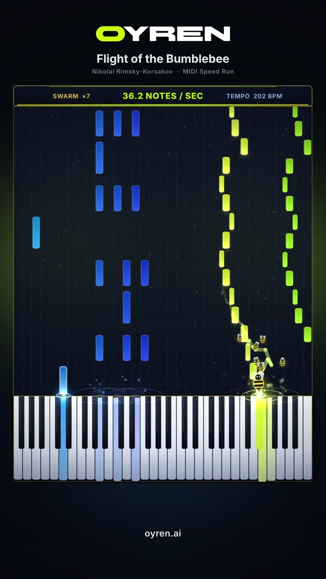 | 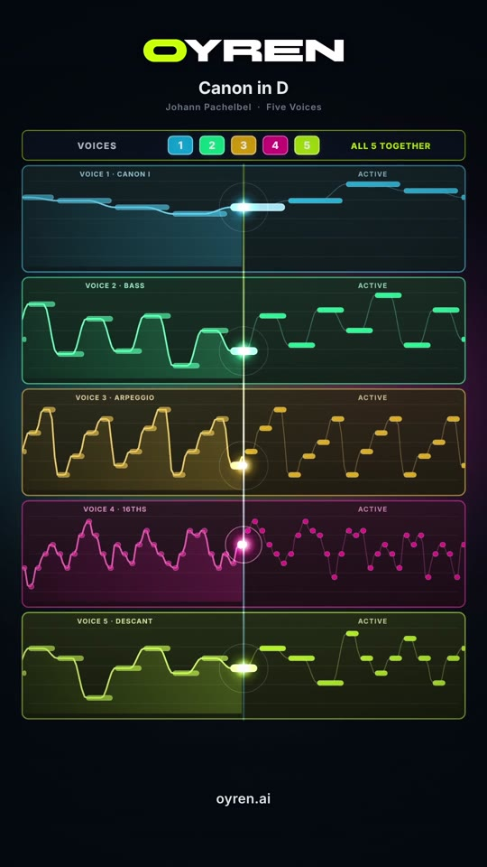 | 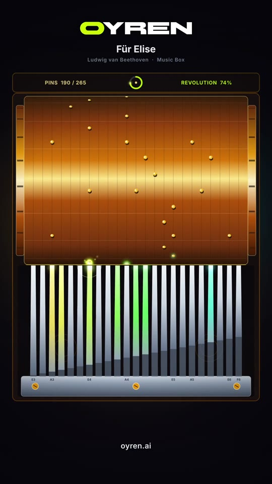 |

| Composition ID | What happens | Good first remix |
| --- | --- | --- |
| `MidiBumblebee` | Rimsky-Korsakov, *Flight of the Bumblebee* (`public/midi/flight-of-the-bumblebee.mid`). Falling MIDI note bars land on a 4-octave keyboard at steady *Vivace* tempo (`148` to `152 BPM`) while a bumblebee and growing swarm (`1` to `7` bees) trace the score-verified chromatic melody up to the 3-octave chromatic finale. | Adjust `BUMBLEBEE_TEMPOS` in `src/midi/pieces.ts` or `FALL_SEC` in `src/midi-bumblebee/sim.ts`. |
| `MidiCanonVoices` | Pachelbel, *Canon in D* (`public/midi/canon-in-d-five-voices.mid`). Five horizontal lanes centred on `x = 540` light up one voice per ground-bass cycle (`VOICES 1..5`), growing from a single violin line into five layered counter-lines (`strings`, `kalimba`, `piano`). | Change lane voice palettes or scrolling scale `PX_PER_SEC` in `src/midi-canon/sim.ts`. |
| `MidiFurEliseMusicBox` | Beethoven, *Für Elise*, WoO 59 (`public/midi/fur-elise-music-box.mid`). A 3D orthographic pinned brass cylinder maps time to angle and pitch to comb position, deflecting and plucking tuned steel teeth (`musicbox` inharmonic cantilever tones) while a centred ring tracks progress. | Tune comb tooth count or `FRONT_HALF_SEC` cylinder lookahead in `src/midi-music-box/sim.ts`. |

### Original modal MIDI compositions (quiet brand layer)

Two original compositions inspired by the jazz-mugham tradition and nocturnal modal jazz are authored from scratch in `src/midi/pieces.ts`, exported as MIT-licensed Standard MIDI Files in [`midi/`](midi/README.md), and framed with `OyrenBrandQuietLayer` (`src/brand/OyrenBrandQuiet.tsx`).

| Mugham Nocturne (original) | Baku Nights (original) |
| --- | --- |
| 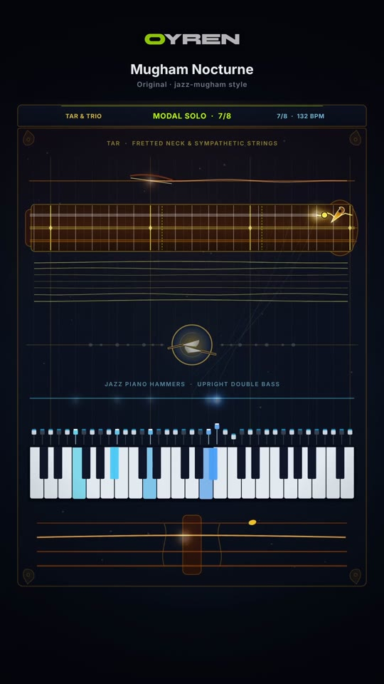 | 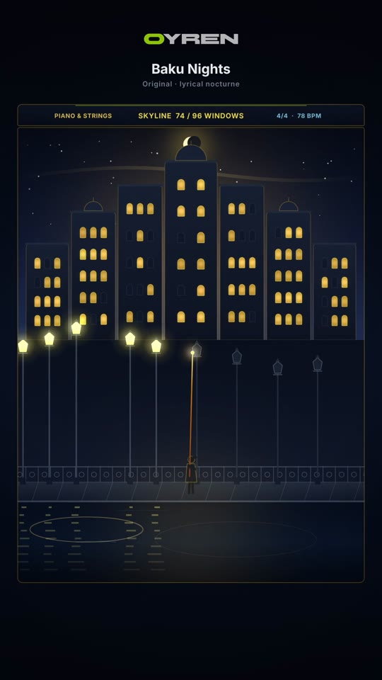 |

| Composition ID | What happens | Good first remix |
| --- | --- | --- |
| `MidiMughamNocturne` | Original composition inspired by the jazz-mugham tradition (`midi/mugham-nocturne.mid`, MIT). Opens with a free-time rubato Tar + bowed Kamancha introduction over a `D2` drone in a D Shur-inspired mode (`+40¢` microtonal pitch-bend on ornamental `Eb`), locks into a `7/8` (`2+2+3`) call-and-response groove and modal solo across a shared Tar/Piano pitch axis, peaks in octave unison, and returns to the `D2` drone. | Adjust the `7/8` call motifs or `+40¢` microtonal inflection in `mughamNocturne()` (`src/midi/pieces.ts`). |
| `MidiBakuNights` | Original slow lyrical nocturne in a C Rast-inspired mode at `78 BPM` (`midi/baku-nights.mid`, MIT; title only, not derived from any existing song). A silhouetted lamplighter at `x = 540` raises an ember-tipped brass pole to ignite one seaside streetlamp per piano melody note (`x` = time, height = pitch) while a symmetric 96-window stone skyline lights up and bass swells cross the harbour water. | Change `SCROLL_SPEED` or window permutation in `src/midi-baku-nights/sim.ts`. |

### Public-domain Azerbaijani operetta melody with original accompaniment (quiet brand layer)

| Arshin Mal Alan — "Askar's Song" (1913) |  |
| --- | --- |
| 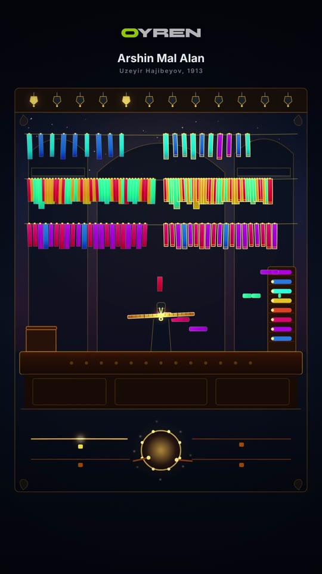 |  |

| Composition ID | What happens | Good first remix |
| --- | --- | --- |
| `MidiArshinMalAlan` | Uzeyir Hajibeyov, *Arshin Mal Alan* (1913), Act II, No. 12 *"Askar's Song"* (`midi/arshin-mal-alan-askars-song.mid`; vocal melody public domain from IMSLP #402316, Baku 1948; arrangement and accompaniment MIT). A street-market cloth peddler behind a walnut counter at `x = 540` measures and snips one silk length along an engraved brass *arshin* stick per vocal melody note (`168` notes verbatim from `flat_full` in sounding tenor register), hanging first-pass cloths left-to-centre and repeated phrases right-to-centre with gold trim before folding them away for the loop. | Adjust `ARSHIN_QUARTER_BPM` (`104..120`) or `ARSHIN_FERMATA_FACTOR` in `src/midi/arshin.ts`. |
